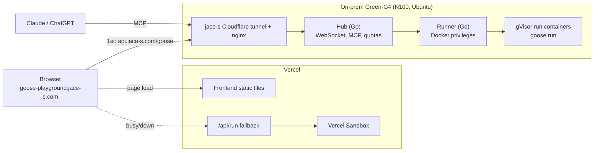

# Architecture Overview

Status: implementation started (2026-11-08). The open planning items below are decided during implementation.

## Summary

The playground runs Goose code on the on-prem server (Green-G4) by default. When on-prem is busy or down, the browser falls back to Vercel Sandbox. User code always runs in an isolated container (gVisor), and one container is used per run.
Users can register the playground's MCP server in Claude or ChatGPT. With the starter prompt, the AI can then edit, check and run code in the user's open browser editor.

Key points in text:
- Vercel serves the frontend and provides the emergency fallback (`/api/run` → Sandbox).
- The browser calls the on-prem `api.jace-s.com/goose` directly. It goes to Vercel only on a 503 (busy) or a connection failure.
- On-prem is split into an internet-facing hub and a privileged runner. Even if the hub is compromised, it can only ask the runner to do isolated runs.
- AI agent mode works only through on-prem.

## Goose Constraints

- The compiler (C++20) emits C. `goose run` builds native x86-64/ARM64 code with the bundled TinyCC.
- WASM is not supported: `docs/design/wasm.md` upstream is an unimplemented proposal, and the runtime depends on reserving multi-GB of address space. So execution has to happen on a server for now.
- Through `extern fn`, user code can call arbitrary C functions. This is why isolation is mandatory.
- Pinned version: v2026.4 (2026-11-06 release, linux-x64 binary about 12 MB). Tentative; see D-0017.

## Components

| Component | Location | Language | Role |
| --- | --- | --- | --- |
| Frontend | Vercel (`goose-playground.jace-s.com`) | TypeScript (Next.js) | Editor, Run/Stop, output, service state banner, AI connection panel, URL-hash sharing |
| Fallback API | Vercel (`/api/run`, region `icn1`) | TypeScript | Runs in Sandbox only when on-prem is unavailable. Refuses when on-prem is healthy |
| Hub | Green-G4 | Go | Browser WebSocket, MCP endpoint, quotas, service state, CORS and Turnstile verification |
| Runner | Green-G4 | Go | Warm pool, run container lifecycle, time and output limits. Called only by the hub |
| Run container | Green-G4 | — | gVisor (runsc), pinned Goose image, one per run |
| Browser syntax check | Browser (WASM) | C++ → Emscripten | Check-only Goose compiler build. Time-boxed feasibility spike |

### Execution Location Abstraction
- Execution is wrapped in a single `runGoose()` backend interface. The frontend and agent do not depend on where code runs.
- If Goose gains WASM support later, an in-browser backend can be added and the server can be demoted to a fallback.

## Isolation

- A throwaway gVisor container per run: `--network none`, read-only rootfs plus a small tmpfs, a non-root user, `--cpus 1`, `--memory 512m`, `--pids-limit 64`, a 10 s timeout, and a 1 MB output cap (defaults, tentative).
- Warm pool: 2 pre-started containers. Measured: a plain `docker run --rm` takes ~0.8 s on Green-G4.
- gVisor install: register the runtime in `daemon.json`, then `systemctl reload docker`. `runtimes` is a live-reloadable option, so jace-s does not stop.
- Only the runner has Docker privileges. The hub reaches the runner only through an internal address.

Scenario:
- Input: User code tries to read a jace-s tunnel token file via `extern fn`.
- Steps: The code runs inside a gVisor container → host files are not mounted → the read fails → the container is deleted after 10 s.
- Result: Server files are not exposed. The run is logged as suspicious (once the abuse submodule exists).

## Agent Mode

- The browser opens a WebSocket to the hub and receives a session token. The starter prompt includes the token.
- The user registers the MCP server in Claude, ChatGPT, Claude Code or Codex once, then only pastes the starter prompt.
- MCP tools (draft; contents are a later planning item):
  - Learning: `goose_docs`, `get_sample`
  - Session (token required): `get_code`, `set_code`, `run`, `check`
- Socket commands are a fixed allow-list: insert code, read code, run, read output. **Running arbitrary JavaScript in the browser is forbidden.**
- The token expires when the tab closes. The page shows an "AI connected" indicator and a disconnect button.
- Execution goes through the runner, and results are sent to both the browser and the AI.
- Quotas use the browser session (real IP, login state). This avoids the problem that claude.ai/ChatGPT MCP calls all arrive from the same few IPs.
- There is no `llms.txt`. AI-facing documentation is served only through MCP.

Scenario:
- Input: The user pastes the starter prompt into claude.ai and asks "write quicksort".
- Steps: `goose_docs` → `set_code(token)` → code appears in the user's editor → `run(token)` → the error shows in the output panel → fix and run again.
- Result: The user watches the AI code in real time in their own browser, and the AI cost is paid by the user's subscription.

## Service States

| State | Condition | Banner | Run |
| --- | --- | --- | --- |
| Normal | On-prem has capacity | None (AI connection available) | On-prem |
| Degraded | On-prem busy or down, Vercel available | "The server is busy, so the AI connection (MCP) is unavailable. You can still use the playground." | Vercel Sandbox |
| Outage | Both unavailable (including the Sandbox quota being exceeded) | "Temporary service outage." | Disabled; editing still works |

- Busy means the runner's concurrent-run cap (2) or the agent session cap is full.
- When agent mode is unavailable, MCP tools return the same message so the AI can explain it to the user.
- The browser rechecks with backoff and recovers automatically.

## Abuse Control

The structure is settled. Numbers and implementation are decided when the abuse submodule is planned.
- Per-session quotas: lower when logged out (IP-based), higher when logged in.
- CPU-second budget: compile and run time are counted against a per-IP or per-user hourly budget.
- Global hourly caps, set separately for on-prem and for Sandbox. Sandbox example: 30/hour, 150/day, derived from the monthly free quota of 5,000 creations.
- Both entry points (on-prem and Vercel fallback) use CORS limited to `goose-playground.jace-s.com`, Cloudflare Turnstile verification, and input size limits.
- Cloudflare rate limiting applies only to the `/goose` path.

## Vercel Hobby Limits

Checked 2026-11-08 against the Vercel docs.
- Functions: 1M invocations/month, 4 active CPU-hours, 300 s maximum duration.
- Sandbox: 5 CPU-hours/month, 420 GB-hours of memory, 5,000 creations, 10 concurrent, 45 minutes per session.
- Non-commercial use only. Exceeding a limit pauses the feature for 30 days; there is no charge.

## Implementation Status

As of 2026-11-08.

| Part | State | Documents |
| --- | --- | --- |
| Run contracts | Draft, awaiting confirmation | [Run API](../api/10-run.md), [Session Socket](../api/20-socket.md) |
| Run image and runner | Implemented, checked on local Docker without gVisor | [Code Run Design](../design/run/10-code-run.md) |
| Hub run and health | Implemented; quotas not yet | [Hub Run Design](../design/run/20-hub-run.md) |
| Playground page | Implemented with a plain text area | [Playground Page Design](../design/web/10-playground-page.md) |
| Vercel fallback | Stub answering `unavailable` | [Vercel Fallback](../specs/run/30-vercel-fallback.md) |
| Agent mode (MCP, socket) | Not started | [Session Socket](../api/20-socket.md) |
| gVisor on the server | Not installed | [gVisor Install](../operations/10-gvisor-install.md) |

## Open Planning Items

1. Submodule split: units, interfaces, implementation order.
2. Abuse control: quota numbers, CPU budget, global caps, code storage scope (proposal: all code 7 days + suspicious code 90 days), suspicious-score rules.
3. Login: which account to use (a jace-s account?), and how to handle `api.jace-s.com` cookies.
4. Data store: where quota counters, run logs and suspicious code are stored.
5. MCP and socket details: endpoint addresses, tool inputs and outputs, `goose_docs` contents, socket command list, token lifetime, agent session cap, starter prompt wording.
6. Privacy notice, needed if code and IPs are stored.
7. Operations: gVisor install procedure, monitoring and alerts, Goose version update procedure.
8. UI: layout, banners, AI connection panel, sample list, mobile support.
9. Confirm the tentative defaults: run limits, concurrency 2, warm pool 2, Goose v2026.4, CLI-only samples, URL sharing, the time box for the browser syntax-check spike, and the GitHub account.
