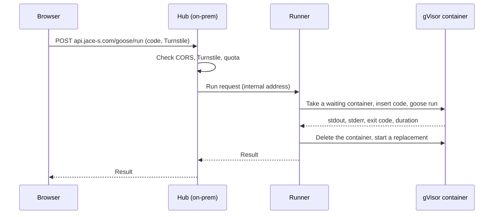
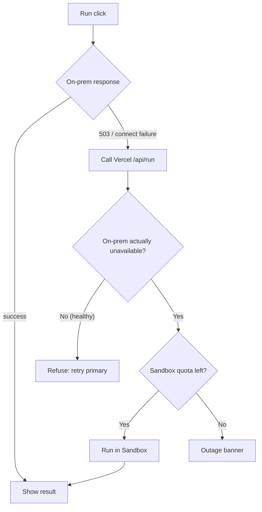
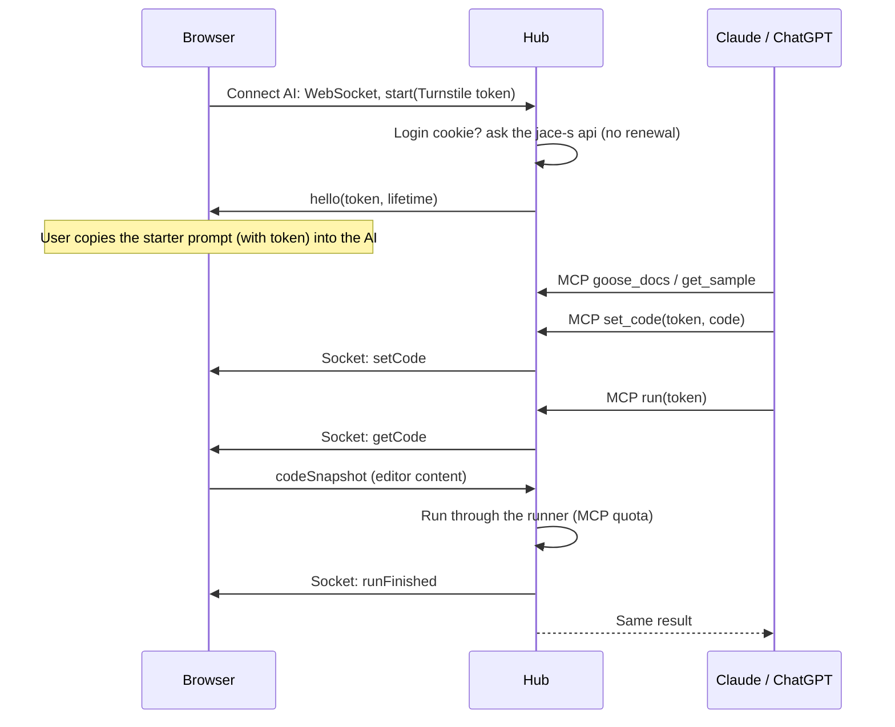
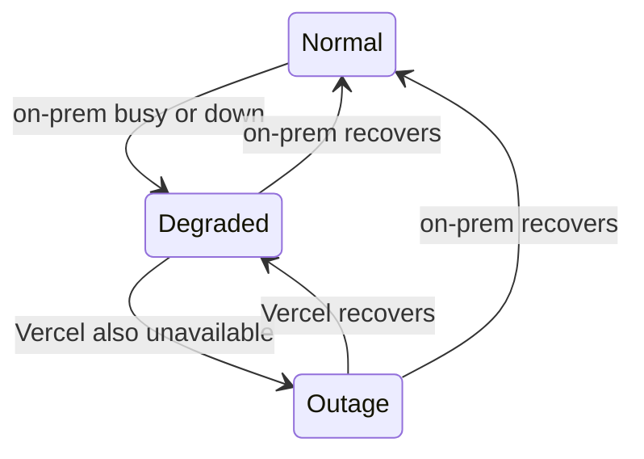
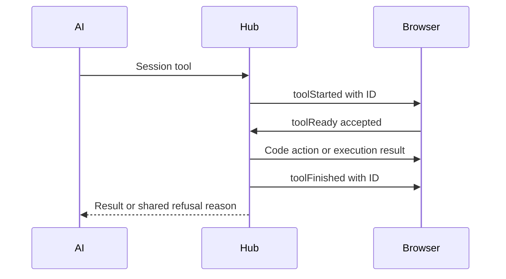

# Data Flow

- Structure: [Architecture Overview](10-overview.md)

## Run Request

The browser calls the on-prem hub first. The hub checks quotas and asks the runner to run the code. The runner runs it in a gVisor container from the warm pool and returns the result.

Scenario:
- Input: A user runs `samples/07_sieve.goose`.
- Steps: The hub verifies → the runner uses a waiting container → `goose run` → output is returned → the container is deleted and replaced.
- Result: Wait time is roughly run time plus network round trip, with no container startup cost.

## Fallback

Implementation: [Vercel Fallback Design](../design/run/30-vercel-fallback.md). The provisional quota counter is shared within a process; a durable cross-instance store remains open.

If on-prem answers 503 (busy) or the connection fails within the short timeout, the browser calls Vercel `/api/run`. Vercel first checks on-prem itself, and refuses with "use the primary" if on-prem is healthy and has capacity. This keeps the Sandbox quota from being consumed by direct attacks.

Scenario:
- Input: Two runs are already executing on-prem when a third request arrives.
- Steps: The hub returns 503 → the browser calls `/api/run` → Vercel confirms on-prem is busy → Sandbox run.
- Result: The user gets a result and sees the Degraded banner. The Sandbox quota is used only for the overflow.

## Agent Session

- The token is bound to that tab's WebSocket. When the tab closes or the user presses Disconnect, the token stops working immediately; it also ends after the idle or maximum time.
- `run` and `check` run what is in the editor, read from the tab at call time.
- Socket messages are a fixed allow-list. The browser does not execute code it receives.
- Example: the AI calls `run` while the tab is in the background and does not answer within 5 s → the AI is told the tab did not answer → nothing runs and nothing is counted.

## Service State Transitions

The browser rechecks the hub health endpoint and the socket connection with backoff and switches state automatically.

## Tool Call Ownership

Every session tool first sends toolStarted; the tab locks manual editing and execution and replies toolReady. After a result or failure, matching toolFinished releases the lock. A browser run already in progress refuses the acknowledgement. Closing the connection releases the local lock. See [AI Connection Design](../design/web/40-ai-connection.md#lock-and-refusal-handling).

