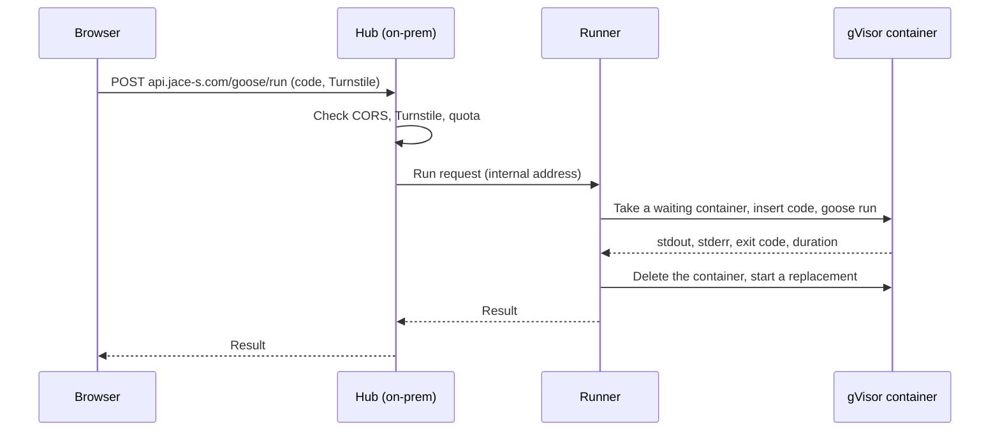
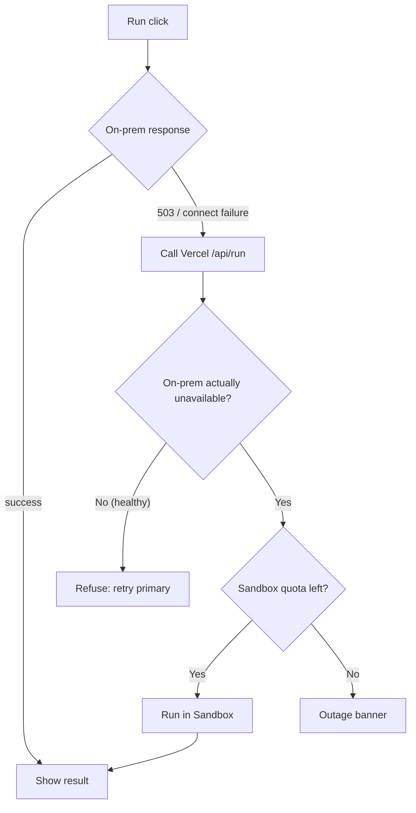
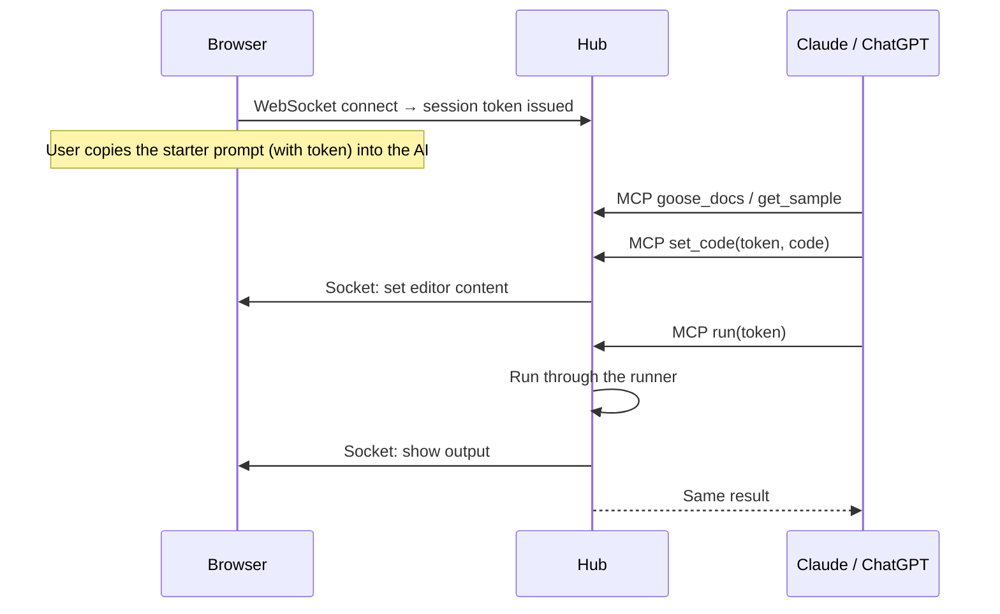
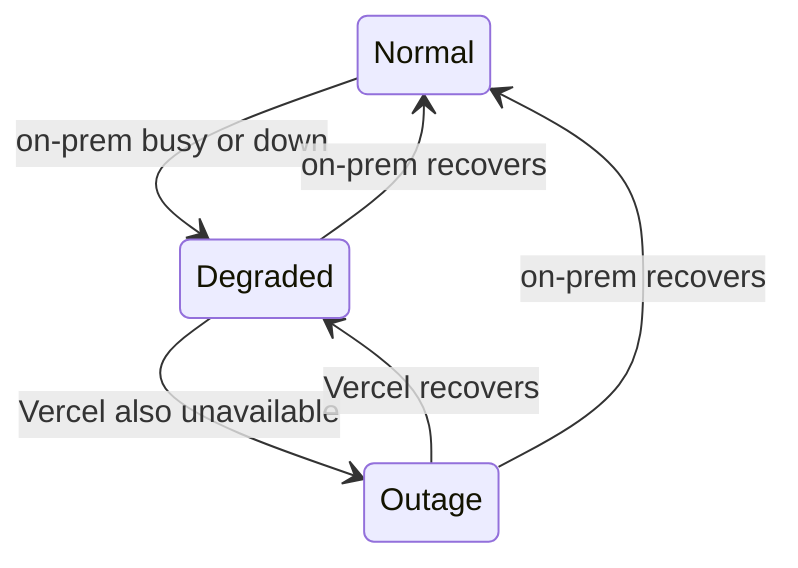

# Data Flow

- Structure: [Architecture Overview](10-overview.md)

## Run Request

The browser calls the on-prem hub first. The hub checks quotas and asks the runner to run the code. The runner runs it in a gVisor container from the warm pool and returns the result.

Scenario:
- Input: A user runs `samples/07_sieve.goose`.
- Steps: The hub verifies → the runner uses a waiting container → `goose run` → output is returned → the container is deleted and replaced.
- Result: Wait time is roughly run time plus network round trip, with no container startup cost.

## Fallback

If on-prem answers 503 (busy) or the connection fails within the short timeout, the browser calls Vercel `/api/run`. Vercel first checks on-prem itself, and refuses with "use the primary" if on-prem is healthy and has capacity. This keeps the Sandbox quota from being consumed by direct attacks.

Scenario:
- Input: Two runs are already executing on-prem when a third request arrives.
- Steps: The hub returns 503 → the browser calls `/api/run` → Vercel confirms on-prem is busy → Sandbox run.
- Result: The user gets a result and sees the Degraded banner. The Sandbox quota is used only for the overflow.

## Agent Session

- The token is bound to that tab's WebSocket. When the tab closes or the user presses Disconnect, the token stops working immediately.
- Socket messages are a fixed allow-list. The browser does not execute code it receives.

## Service State Transitions

The browser rechecks the hub health endpoint and the socket connection with backoff and switches state automatically.
