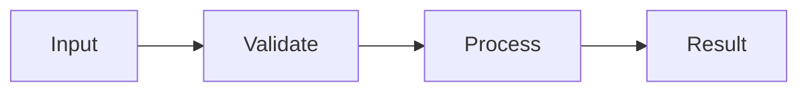
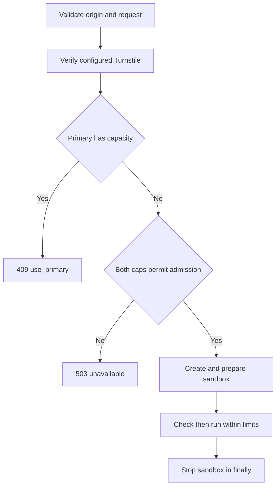

# Vercel Fallback Design

- Spec: [Vercel Fallback](../../specs/run/30-vercel-fallback.md)
- Architecture: [Overview](../../architecture/10-overview.md), [Data Flow](../../architecture/20-data-flow.md)
- All scenarios: [Vercel Fallback Scenarios](../../testing/scenarios/run/30-vercel-fallback.md)

## Implementation

- Input: RunRequest and exact Origin header; optional Turnstile token
- Output: RunResult with backend sandbox or an API ErrorResponse
- Code: frontend/src/app/api/run/route.ts, frontend/src/lib/fallback/handler.ts, frontend/src/lib/fallback/counter.ts, frontend/src/lib/fallback/execute.ts, frontend/src/lib/fallback/vercel.ts
- Steps: Validate origin and UTF-8 size, verify Turnstile when configured, check primary health within 2 seconds, admit against both caps, prepare and check then run, always stop

## Example

- Input: RunRequest and exact Origin header; optional Turnstile token
- Steps: Validate origin and UTF-8 size, verify Turnstile when configured, check primary health within 2 seconds, admit against both caps, prepare and check then run, always stop
- Expected result: A healthy primary returns 409 use_primary without consuming quota or creating a sandbox

## Public Interfaces

- `createFallback(options)` returns a POST handler. `FallbackOptions` injects fetch, hub origin, Turnstile secret, caps, counter and sandbox factory.
- `RunCounter.take(now, hourlyCap, dailyCap)` atomically reserves one run. `MemoryRunCounter` uses UTC fixed hourly and daily windows, shared by every request in the current process. Failed creations consume admission conservatively. A real shared store is still required before caps span multiple server instances and cold starts.
- `RunSandbox.prepare(code)` installs the pinned compiler and writes source. `command(phase, options)` receives the remaining deadline, cancellation signal and byte output callback; it returns an exit code. `stop()` terminates the sandbox.
- `executeSandbox(sandbox, code)` bounds check plus run to 10 seconds, streams combined output up to 1 MiB, returns structured diagnostics, maps exit 137 or negative exit to killed, and stops in a finally block. Setup time is excluded, as container startup is excluded on-prem. Setup failures answer unavailable.
- `createVercelSandbox()` creates a fresh Ubuntu-based vercel/sandbox/node:24 SDK sandbox, downloads Goose v2026.4 linux-x64, retries the same pinned release asset through the GitHub API when the browser download endpoint fails, verifies SHA-256 before extraction, installs libc development headers, writes code without shell interpolation and disables networking before checking. Commands run as UID 10001 with a cleared environment, 64-process and 512 MiB address-space limits. stdin is closed.
- `POST(request)` supplies environment settings and a module-wide counter. `HUB_URL` defaults to https://api.jace-s.com; `TURNSTILE_SECRET` enables verification; `SANDBOX_HOURLY_CAP` and `SANDBOX_DAILY_CAP` default to 30 and 150. Explicit zero disables admission. Node runtime and a 120 second function ceiling permit setup and cleanup; the sandbox has a separate 60 second lifetime ceiling.
- SDK reference: https://vercel.com/docs/sandbox/sdk-reference, checked against @vercel/sandbox 3.9.1 on 2026-11-08. Live verification also checks compiler compatibility and hello output in the deployed SDK environment.

## Admission Flow

The primary check runs before quota admission or sandbox creation. Rejected inputs never create a sandbox. Compiler rejection never executes the run phase.

## Open Questions

- Which shared counter store should replace the explicitly provisional process-local implementation for multi-instance deployments?
- Resolved 2026-11-09: the browser obtains a fresh token for the fallback request; see [Playground Page Design](../web/10-playground-page.md#turnstile-widget).
- The deployed SDK sandbox has passed hello execution; the production smoke test is recorded in the deployment operations document.
