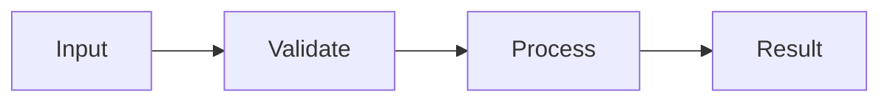

# Contract Types Design

- Spec: [Contract Types](../../specs/web/15-contract-types.md)
- Architecture: [Overview](../../architecture/10-overview.md), [Data Flow](../../architecture/20-data-flow.md)
- All scenarios: [Contract Types Scenarios](../../testing/scenarios/web/15-contract-types.md)

## Implementation

- Input: schema/*.schema.json
- Output: Generated TypeScript types and schema validation
- Code: frontend/scripts/gen-contract.mjs, frontend/scripts/gen-contract.test.ts, frontend/src/lib/contract.ts, frontend/src/lib/generated/
- Steps: Generate all schemas then compare committed text and validate every example with Ajv 2020

## Example

- Input: schema/*.schema.json
- Steps: Generate all schemas then compare committed text and validate every example with Ajv 2020
- Expected result: An unregenerated schema change fails the freshness test and names the schema
