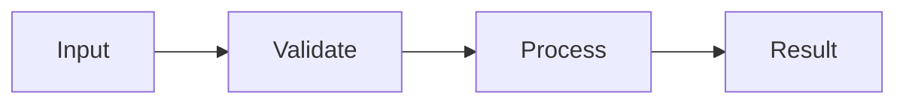

# Samples Design

- Spec: [Samples](../../specs/web/20-samples.md)
- Architecture: [Overview](../../architecture/10-overview.md), [Data Flow](../../architecture/20-data-flow.md)
- All scenarios: [Samples Scenarios](../../testing/scenarios/web/20-samples.md)

## Implementation

- Input: Release sample selection and current editor text
- Output: Confirmed replacement with a bundled CLI sample
- Code: frontend/src/samples/index.ts, frontend/src/samples/*.goose, frontend/src/components/Playground.tsx
- Steps: Pick sample then compare with the last loaded text; confirm replacement of edits; load static sample text

## Example

- Input: Release sample selection and current editor text
- Steps: Pick sample then compare with the last loaded text; confirm replacement of edits; load static sample text
- Expected result: Selecting 07_sieve after editing hello asks for confirmation and Run prints 664579 primes up to 10000000
