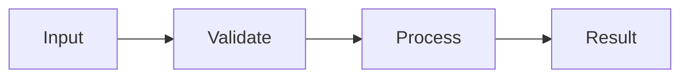

# URL Sharing Design

- Spec: [URL Sharing](../../specs/web/30-url-sharing.md)
- Architecture: [Overview](../../architecture/10-overview.md), [Data Flow](../../architecture/20-data-flow.md)
- All scenarios: [URL Sharing Scenarios](../../testing/scenarios/web/30-url-sharing.md)

## Implementation

- Input: Current source text and page URL or code hash
- Output: A copied share URL or decoded source with bounded size
- Code: frontend/src/lib/share.ts, frontend/src/lib/share.test.ts, frontend/src/components/Playground.tsx
- Steps: Encode UTF-8 then deflate-raw then unpadded base64url; check complete URL length; inflate incrementally up to 65536 bytes when opening

## Example

- Input: Current source text and page URL or code hash
- Steps: Encode UTF-8 then deflate-raw then unpadded base64url; check complete URL length; inflate incrementally up to 65536 bytes when opening
- Expected result: Korean source survives sharing; invalid or oversized input shows the specified message

## Toolbar Appearance

The Share button uses the themed secondary share class; shareMessage styles the status feedback and hides it when empty. See [Toolbar Controls](10-playground-page.md#toolbar-controls).
