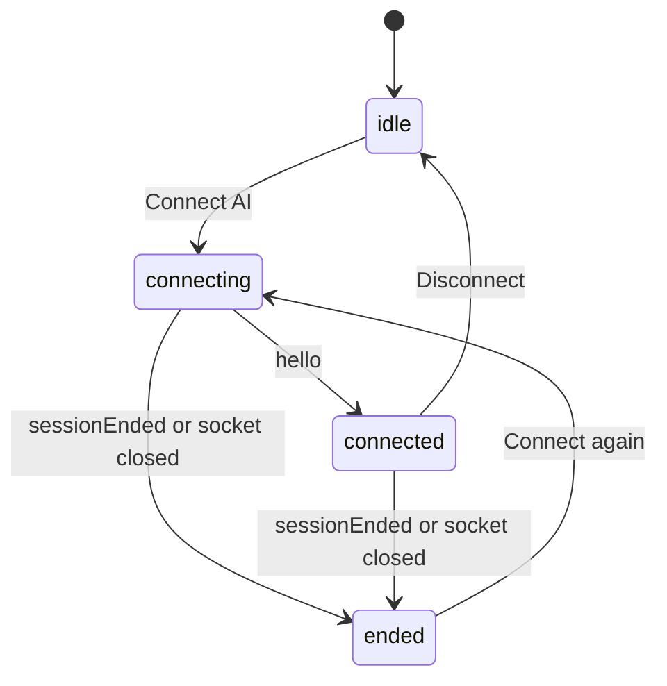

# AI Connection Design

- Spec: [AI Connection](../../specs/web/40-ai-connection.md)
- Architecture: [Data Flow](../../architecture/20-data-flow.md#agent-session)
- API: [Session Socket](../../api/20-socket.md)
- All scenarios: [AI Connection Scenarios](../../testing/scenarios/web/40-ai-connection.md#ai-connection-scenarios)

The tab is the editor's only owner. The hub forwards the AI's requests as socket messages; the tab answers with the editor content or applies a replacement, and shows results.

## Session Client

- Input: socket URL (`endpoints.session`), handlers (`onLock`, `onUnlock`, `getCode`, `setCode`, `onStarted`, `onRunFinished`, `onCheckFinished`, `onToolFailed`, `onState`), optional `getToken` for Turnstile.
- Output: `AgentConnection` with `disconnect()`; states `idle`, `connecting`, `connected` (token, loggedIn, idleSeconds, expiresAt, last tool and time), `ended` (reason).
- Code: `frontend/src/lib/agentSession.ts` → `connectAgent()`, `parseHubMessage()`, `starterPrompt()`, `END_MESSAGE`.
- Steps:
  1. Open the WebSocket; on open get a Turnstile token when configured (failure → `ended(error)`) and send `start`.
  2. `parseHubMessage` keeps only allow-listed hub messages with the right field types; everything else is dropped.
  3. `hello` → connected. `toolStarted` → synchronously request the page lock and reply `toolReady`; `setCode` → replace the editor while locked. `getCode` → send `codeSnapshot` with the current editor content while locked. `toolFinished` → release the matching lock. Started, finished and failed messages go to the output panel. `aiActivity` updates the last action.
  4. `sessionEnded` → ended with its reason; a close without it → ended `lost`. `disconnect()` sends `disconnect`, closes and returns to idle.
- Scenario: The hub sends `{"type":"eval","code":"alert(1)"}` → `parseHubMessage` returns null → nothing happens.

## Panel And Page

- Code: `frontend/src/components/AiPanel.tsx`; `Playground.tsx` → `connectAI()`, `disconnectAI()`; `OutputPanel.tsx` → `PanelOutcome`, `byAI`, `busy`.
- `Playground` keeps the editor content in `codeRef` so `getCode` answers with the latest text without reconnecting. An AI `setCode` marks the editor edited, so a shared link loaded later does not overwrite it.
- Connect is enabled by `agentAllowed(state, health)` (Normal and `agentAvailable`). Unmounting the page disconnects.
- The output panel shows "AI · " before the status of AI results and a check result (`Check passed`, `Compile error`, limits) with diagnostics.
- Setup help is a collapsed `details` element with the MCP URL (`endpoints.mcp`) and registration steps.
- Layout: the shell is a flex column, so the editor panes take the spare height and the AI panel keeps its own height. On narrow screens the toolbar shortcut hint is hidden but the panel's hints stay visible.
- Scenario: The AI calls `run` → lock handshake → `runStarted` → the output panel says "AI is running the code…" → `runFinished` → "AI · Exited with code 0 · 140 ms · server".

## Lock And Refusal Handling

- Input: toolStarted with call ID and tool; current browser run state; matching toolFinished or session end.
- Output: toolReady accepted or refused, read-only editor, disabled sample picker and Run, visible lock reason and independent failure notice.
- Code: `frontend/src/lib/agentSession.ts` → `AgentHandlers.onLock`, `onUnlock`, `connectAgent`; `frontend/src/components/Playground.tsx` → `aiLockRef`, `browserRunning`, `aiLock`, `aiNotice`, `run`.
- connectAgent retains the accepted ID; overlapping starts are refused without changing it. Stale finishes and toolFailed never release it. End and Disconnect release it once. setCode and getCode without ownership are ignored.
- Playground sets refs synchronously before sending acceptance, so a keyboard or click event in the same render cycle cannot bypass the lock. Rendering uses state for readOnly, disabled and an accessible reason. Event handlers also check the ref for edits, sample replacement and Run. Disconnect remains usable.
- While a browser run is pending, onLock refuses the AI tool. Failure notices do not overwrite browser output or clear another AI operation's busy state. Subsequent tool acceptance clears the old notice.
- Shared URL restoration does not overwrite an actively locked editor. Share remains usable because it reads code rather than replacing or executing it.
- Scenario: A run owns t1 and a set_code fails → display its reason without clearing t1 → stale toolFinished for t2 does nothing → toolFinished t1 unlocks.
- Full cases: [AI Connection Scenarios](../../testing/scenarios/web/40-ai-connection.md).
