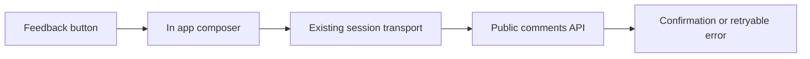

# Feedback Dialog Design

- Input: Feedback button activation, draft text, current session, optional guest password and motion preference.
- Output: An in app composer, a public comment confirmation or a retryable error.
- Code: frontend/src/components/FeedbackDialog.tsx, frontend/src/components/Playground.tsx, frontend/src/components/Playground.module.css, frontend/src/lib/account.ts.

The header mounts FeedbackDialog using an HTML dialog and showModal. The browser traps focus and restores it on close. The existing account client supplies credentialed requests and CSRF. Guest feedback needs an edit password; signing in opens the existing LoginDialog above the composer. sourceAppId is 11.

- Spec: [Feedback Dialogs](../../specs/web/60-feedback-dialogs.md)
- Architecture: [Overview](../../architecture/10-overview.md)
- Scenarios: [Feedback Dialogs](../../testing/scenarios/web/60-feedback-dialogs.md)

## Example

- Input: A visitor opens Feedback with reduced motion disabled.
- Steps: Display the animated composer, enter a draft, receive a failed API response and retry explicitly.
- Expected result: The draft remains available for retry and clears only on success.

## Background Scroll

While the dialog is mounted, root and body scrolling are locked and restored on unmount. This prevents existing header overflow from widening the mobile visual viewport around the composer.
