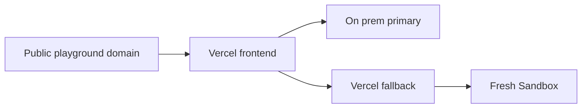

# Vercel Deployment

## Production

- Project: goose-playground in the existing jace0827s-projects account.
- Source: Goose Playground repository, frontend root directory, Next.js, Node 24.
- Public origin: https://goose-playground.jace-s.com.
- The Vercel deployment serves the editor and POST /api/run. The on-prem hub and runner remain separate services.
- OIDC is enabled for the project so the fallback SDK can authenticate without a stored access token.
- Uploads exclude local private files, temporary files, debugging scripts, environment files and build caches through .vercelignore.
- Required runtime settings: HUB_URL defaults to https://api.jace-s.com; SANDBOX_HOURLY_CAP and SANDBOX_DAILY_CAP default to 30 and 150. TURNSTILE_SECRET is optional and must be supplied through the secret store, never committed. NEXT_PUBLIC_TURNSTILE_SITE_KEY is read at build time, so a change needs a new deployment.
- Design: [Vercel Fallback](../design/run/30-vercel-fallback.md).

## Publish

The Vercel project is connected to the Goose Playground GitHub repository with production branch main (D-0051). A push to main builds and deploys production; other branches do not deploy, because `frontend/vercel.json` sets `git.deploymentEnabled` to main only.

1. Run the server and frontend checks documented in [Testing Strategy](../testing/10-strategy.md).
2. Merge the reviewed product dev branch into product main and push it. Vercel starts the production build.
3. Commit the product revision in the platform and merge platform dev into main before pushing it.
4. Verify the public page and run a hello program through /api/run. Inspect logs if the fallback reports unavailable.

A manual `vercel deploy --prod` from a linked clone still works for a redeploy without a commit.

Example:
- Input: A commit on dev that changes the starter prompt.
- Steps: Fast-forward main to dev and push → Vercel builds main from the frontend root directory → the production alias moves to the new deployment.
- Expected result: The public page serves the new prompt; pushing dev alone creates no deployment.

## Domain

Cloudflare keeps the authoritative nameservers. Only the goose-playground CNAME points to the exact target recommended by the Vercel domain verification command. The record is DNS only so Vercel terminates TLS.

The browser tries the primary first and uses the fallback when it is unavailable. A healthy primary refuses fallback admission.

## Example

- Input: Production deployment and a hello program submitted with the exact public Origin.
- Steps: Open the page, press Run, inspect the result and verify the sandbox stops.
- Expected result: The output contains Hello, Goose and the backend is onprem or sandbox according to primary availability.

## Runtime Verification

- The function uses Node 24 and the Sandbox uses the Ubuntu-based vercel/sandbox/node:24 managed image. The legacy runtime named node24 uses an older GLIBC and cannot run this Goose release.
- Setup verifies goose --version before processing source so an incompatible compiler is an infrastructure failure rather than an empty compiler diagnostic response.
- Verified on 2026-11-08: exact domain CNAME and HTTPS certificate, successful Vercel production build, live SDK check exit 0, and hello execution exit 0 with Hello, Goose output.

## Turnstile Rollout

The page sends tokens only when built with the site key, and the hub and the fallback require tokens only when their secret is set. Enable it in this order so runs never fail for missing tokens:

1. Deploy the page built with `NEXT_PUBLIC_TURNSTILE_SITE_KEY` (Production). Runs now carry tokens, which are ignored while secrets are empty.
2. Set `TURNSTILE_SECRET` in Vercel (Production) and redeploy, and set it for the hub on the platform side.
3. Check that a browser run works and that a request without a token is refused with 403 `turnstile_failed`.

To turn it off, remove the secrets first, then the site key.

- Input: Site key deployed, secrets empty.
- Steps: Press Run, then add both secrets and press Run again.
- Expected result: Both runs succeed; a curl request without a token now gets 403.
