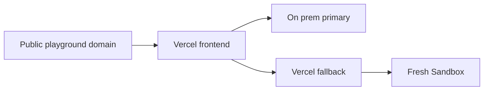

# Vercel Deployment

## Production

- Project: goose-playground in the existing jace0827s-projects account.
- Source: Goose Playground repository, frontend root directory, Next.js, Node 24.
- Public origin: https://goose-playground.jace-s.com.
- The Vercel deployment serves the editor and POST /api/run. The on-prem hub and runner remain separate services.
- OIDC is enabled for the project so the fallback SDK can authenticate without a stored access token.
- Uploads exclude local private files, temporary files, debugging scripts, environment files and build caches through .vercelignore.
- Required runtime settings: HUB_URL defaults to https://api.jace-s.com; SANDBOX_HOURLY_CAP and SANDBOX_DAILY_CAP default to 30 and 150. TURNSTILE_SECRET is optional and must be supplied through the secret store, never committed.
- Design: [Vercel Fallback](../design/run/30-vercel-fallback.md).

## Publish

1. Run the server and frontend checks documented in [Testing Strategy](../testing/10-strategy.md).
2. Merge the reviewed product dev branch into product main and push the product branches first.
3. Commit the product revision in the platform and merge platform dev into main before pushing it.
4. Link the local Goose repository with vercel link, selecting goose-playground and the existing account.
5. Run vercel deploy --prod from the Goose repository. The project root setting selects frontend.
6. Verify the public page and run a hello program through /api/run. Inspect logs if the fallback reports unavailable.

## Domain

Cloudflare keeps the authoritative nameservers. Only the goose-playground CNAME points to the exact target recommended by the Vercel domain verification command. The record is DNS only so Vercel terminates TLS.

The browser tries the primary first and uses the fallback when it is unavailable. A healthy primary refuses fallback admission.

## Example

- Input: Production deployment and a hello program submitted with the exact public Origin.
- Steps: Open the page, press Run, inspect the result and verify the sandbox stops.
- Expected result: The output contains Hello, Goose and the backend is onprem or sandbox according to primary availability.
